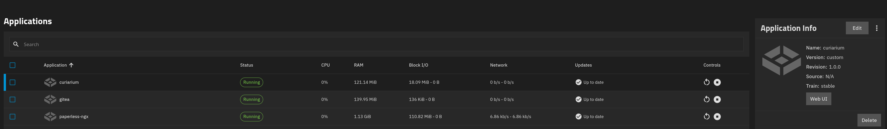

TrueNAS Installation Guide

Tested on TrueNAS 27.0.0-RC.1 , 

Apps run as a built-in non-root account called `apps`, which has UID 568 and GID 568.

```bash
truenas_admin@backup[~]$ getent passwd 568
apps:x:568:568:Unprivileged Apps User:/var/empty:/usr/sbin/nologin
truenas_admin@backup[~]$ getent group 568
apps:x:568:
```

For the sake of this guide, Curiarium will use datasets within `/mnt/tank/configs` on a ZFS pool called `tank`.

## ZFS Datasets

Step 1. Create a dataset called `curiarium` with the parent path `tank/configs` (giving `tank/configs/curiarium`). Set the preset to `Generic`.


Step 2. Add a dataset called `storage` to the `curiarium` dataset from Step 1, using the `Apps` preset.


Step 3. Add a dataset called `data` to the `curiarium` dataset from Step 1, using the `Generic` preset.


Step 4. Open the Permissions tab for the `data` dataset and select `Edit`.


Set the following permissions:

- User = `netdata`
- Group = `docker`
- Untick the Other read/write permissions
- Tick `Apply permissions recursively`

Then select `Save`.


## Setup Environment

Create the `.env` file. Change `PUBLIC_URL=` to suit your setup.

`PUBLIC_URL` uses HTTPS in this example, but the app itself serves plain HTTP on port 5173. For an HTTPS URL you need a reverse proxy that terminates TLS and forwards all paths to port 5173. If you only access Curiarium on your LAN over HTTP, leave `PUBLIC_URL` empty and use `CORS_ORIGINS` instead.

**Optional:** `CORS_ORIGINS` is a comma-separated list of web addresses that the API will allow to call it from a browser.

**Background.** Browsers enforce the same-origin policy. A page loaded from one origin (scheme, host and port together) cannot read responses from a different origin unless that server says it is allowed, using CORS headers. This means `http://curiarium.example.com:5173` and `http://IP:5173` are different origins, even though they reach the same server.

```bash
sudo tee /mnt/tank/configs/curiarium/.env >/dev/null <<EOF
PUID=568
PGID=568
CHOWN_MODE=minimal
FILE_STORAGE=/app/storage
DB_URL=sqlite:////app/data/curiarium.db
PUBLIC_URL=https://curiarium.example.com
# CORS_ORIGINS=http://curiarium.example.com:5173,http://IP:5173
VITE_API_URL=
AUTH_MODE=auto
AUTH_USERNAME=admin
AUTH_PASSWORD=change-me-to-something-strong
AUTH_SECRET=$(openssl rand -hex 32)
AUTH_ACCESS_TOKEN_TTL=900
AUTH_REFRESH_TTL_SECONDS=2592000
MAX_UPLOAD_MB=4096
EOF
```

If your password contains `$` or a backtick, the shell will expand it inside this heredoc. Edit the file afterwards, or quote the delimiter (`<<'EOF'`) and paste a pre-generated secret instead of using `$(openssl ...)`.

Set the file to mode `600`, owned by `apps:apps`:

```bash
sudo chown 568:568 /mnt/tank/configs/curiarium/.env
sudo chmod 600 /mnt/tank/configs/curiarium/.env
```

## Install App

Select `Discover Apps`.


Select `More Options`.


Select `Install via YAML`.


In the name field enter `curiarium`, then paste the following into the `Custom Config` field:

```yaml
services:
  api:
    container_name: c_api
    devices:
      - /dev/zfs:/dev/zfs
    env_file:
      - /mnt/tank/configs/curiarium/.env
    image:  ghcr.io/insanemal/curiarium-api:edge-zfs
    restart: unless-stopped
    volumes:
      - bind:
          propagation: rslave
        source: /mnt/tank/configs/curiarium/storage
        target: /app/storage
        type: bind
      - /mnt/tank/configs/curiarium/data:/app/data
  web:
    container_name: curiarium_web
    depends_on:
      - api
    env_file:
      - /mnt/tank/configs/curiarium/.env
    image: ghcr.io/insanemal/curiarium-web:edge
    ports:
      - '5173:5173'
    restart: unless-stopped

x-portals:
  - host: 0.0.0.0
    name: Web UI
    path: /
    port: 5173
    scheme: http
```

If using HTTPS change `scheme: http` to `scheme: https`

**Portal Fix Hand Jam**

While testing TrueNAS 27.0.0-RC.1 it was noticed that portals defined in custom apps are not detected by the middleware so the following kludge can be used in the interium

And this can also be applied to other apps using `/root/sync-portals.sh <APPNAME>`

```
cat > /root/sync-portals.sh <<'EOF'
#!/bin/sh
# KLUDGE: TrueNAS 27.0.0-RC.1 does not support x-portals for custom apps.
# The middleware skips portal discovery when custom_app is true (see the TODOs in
# middlewared/plugins/apps/crud.py and ix_apps/metadata.py), so the Web UI button
# never appears even though x-portals is present in the rendered compose file.
# This script calls the middleware's own portal update function by hand and then
# regenerates the collective metadata. Rerun it after creating or editing a custom app.
# Remove it once custom app portal support lands upstream.
#
# usage: sync-portals.sh <app> [<app> ...]
for APP in "$@"; do
  VER=$(midclt call app.query "[[\"name\",\"=\",\"$APP\"]]" | jq -r '.[0].version')
  python3 -c "from middlewared.plugins.apps.ix_apps.metadata import update_app_metadata_for_portals as f; f('$APP','$VER')"
done
midclt call -j app.metadata.generate
for APP in "$@"; do
  echo "$APP:"; midclt call app.query "[[\"name\",\"=\",\"$APP\"]]" | jq '.[0].portals'
done
EOF
```

Set Permissions 

```
chmod +x /root/sync-portals.sh
```

/root/sync-portals.sh curiarium 

Example output 

```
root@backup[~]# /root/sync-portals.sh curiarium  
Status: Updated metadata configuration for apps
Total Progress: [########################################] 100.00%
null
curiarium:
{
  "Web UI": "http://0.0.0.0:5173/"
}
```

### Application Running within Truenas



### Main Login 


